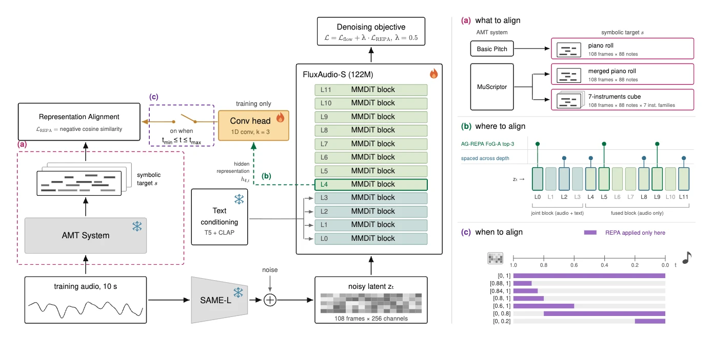
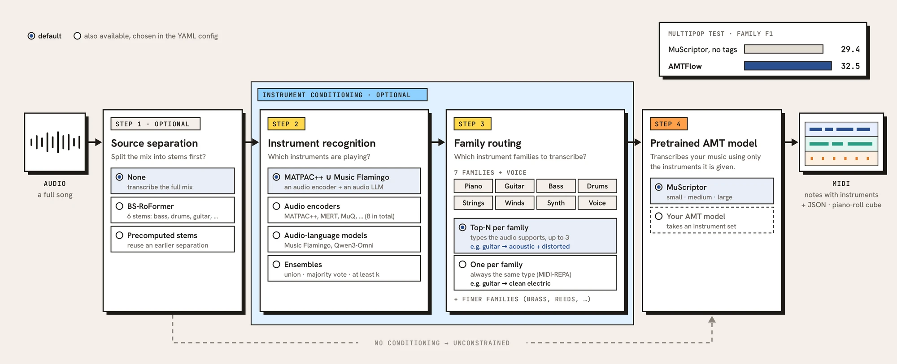
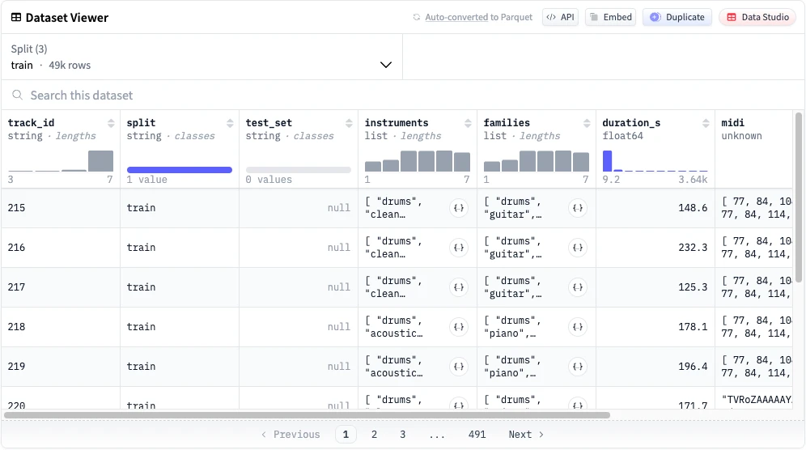

<div align="center">

# MIDI-REPA

### Improving Text-to-Music Generation with Symbolic Representation Alignment

Song-Ze Yu, Fang-Duo Tsai, Yi-Hsuan Yang

<sub>National Taiwan University</sub>

<br/>

[](https://arxiv.org/abs/2610.20967)
[](https://github.com/vaclisinc/AMTFlow)
[](https://huggingface.co/datasets/vaclis/JamendoMIDI)

</div>

<p align="center">
  <a href="https://midi-repa.vaclis.net/">
    
  </a>
  <br/>
  <sub>Click the figure to open the demo page with audio examples.</sub>
</p>

## Code & Resources

<table>
  <tr>
    <td width="50%" valign="top">
      <a href="https://github.com/vaclisinc/AMTFlow"></a>
      <br/><sub>PIPELINE</sub>
      <br/><a href="https://github.com/vaclisinc/AMTFlow"><b>AMTFlow ↗</b></a>
      <br/>Transcription pipeline used for the paper. To reproduce, run with <code>--config paper</code>.
    </td>
    <td width="50%" valign="top">
      <a href="https://huggingface.co/datasets/vaclis/JamendoMIDI"></a>
      <br/><sub>DATASET</sub>
      <br/><a href="https://huggingface.co/datasets/vaclis/JamendoMIDI"><b>JamendoMIDI ↗</b></a>
      <br/>Multi-instrument MIDI transcriptions of 51,077 instrumental Jamendo tracks. CC BY-NC-SA 4.0.
    </td>
  </tr>
</table>

This repository contains the code to reproduce every experiment in the paper: data
preparation from JamendoMIDI, training of all fifteen arms of the *what / where / when*
study, generation, and the SDD and ATTM evaluations, including FoG-A (Table 2) and the
trajectory figure (Fig. 2).

```text
midi_repa/
  model/          FluxAudio-S (adapted from the ATTM baseline; checkpoint-compatible)
  repa.py         block tap, temporal-conv projector, masked cosine loss (Eq. 1-2)
  train.py        training entrypoint            data.py   window dataset
  generate.py     text -> audio                  flow.py   flow matching + Euler sampler
  prep/           JamendoMIDI, SAME-L latents, manifests, piano rolls, text features
  eval/           SDD/ATTM prompts and references, official FAD/CLAP, CCS, seed CIs,
                  FoG-A, Fig. 2
configs/base.yaml + configs/arms/*.yaml      one file per arm of the paper
assets/           latent statistics, instrument palette, SDD and ATTM evaluation lists
```

## Setup

Python 3.11 and [uv](https://docs.astral.sh/uv/). The paper's environment used torch 2.7.1
with CUDA 12.6.

```bash
uv sync --extra wandb --extra analysis          # add --extra basic-pitch / --extra ccs as needed
uv run bash scripts/setup_third_party.sh        # stable-audio-3, basic-pitch-torch, ATTM eval
                                                # at pinned commits + CFG null-prompt features
# Separate environment for the official ATTM FAD/CLAP scripts (they pin numpy 1.26):
uv venv --python 3.11 .venv-eval
uv pip install --python .venv-eval -r envs/eval-requirements.txt --index-strategy unsafe-best-match
```

Weights are fetched from Hugging Face on first use: the SAME-L autoencoder bundled with
[`stabilityai/stable-audio-3-medium`](https://huggingface.co/stabilityai/stable-audio-3-medium)
(accept its license and `huggingface-cli login` first), `google/flan-t5-large`, and the
LAION-CLAP `music_speech_audioset_epoch_15_esc_89.98.pt` checkpoint.

## Data

| What | Where |
|---|---|
| MIDI targets and train / monitor / test splits | [JamendoMIDI](https://huggingface.co/datasets/vaclis/JamendoMIDI), downloaded by `prep jamendomidi` |
| Vocal-removed Jamendo audio (55,701 mp3) | MTG-Jamendo `raw_30s` + the ATTM [preprocessing pipeline](https://github.com/ntu-musicailab/ICME26-ATTM-GC-Preprocessing) |
| Qwen and Music Flamingo captions (`qwen.json`, `music_flamingo.json`) | ATTM challenge release |
| Song Describer captions (`song_describer.csv`) | [Zenodo 10072001](https://zenodo.org/records/10072001) |

```bash
DATA=/path/to/prepared AUDIO=/path/to/vocal_removed_mp3
uv run python -m midi_repa.prep jamendomidi --root $DATA      # MIDI + splits.csv
uv run python -m midi_repa.prep latents     --root $DATA --audio-dir $AUDIO   # shard with --worker/--workers
uv run python -m midi_repa.prep manifest    --root $DATA --qwen-captions qwen.json \
                                            --flamingo-captions music_flamingo.json
uv run python -m midi_repa.prep rolls       --root $DATA      # MuScriptor cube + merged roll
uv run python -m midi_repa.prep text        --root $DATA      # T5 + CLAP caption features
uv run python -m midi_repa.prep basic-pitch --root $DATA --audio-dir $AUDIO   # Table 1 only
```

This gives 49,034 training tracks (1,138,005 complete 10-second windows, about 3,161 hours)
and 444 monitoring windows. Each track keeps one of the two caption sources for the whole run,
and every window is a 108 x 256 SAME-L latent with 108 x 88 (roll) or 108 x 616 (cube)
binary targets. The 1,599 held-out test tracks are never trained on.

## Training

```bash
uv run torchrun --nproc_per_node=1 -m midi_repa.train configs/arms/mus_roll_l2.yaml \
    data.root=$DATA output_dir=runs/mus_roll_l2 wandb.enabled=true
```

All arms share `configs/base.yaml`: AdamW, global batch 128, 300k updates, learning rate
1e-4 with 1k warm-up and tenfold drops at 240k and 270k, lambda = 0.5, t = sigmoid(u) with
u ~ N(0, 1), bf16, and seed 14159265. The paper's final model takes about 31 hours on one
RTX 3090. Training resumes from `ckpt_last.pth`. The run ends by writing `ema_final.pth`,
the post-hoc EMA with sigma_rel = 0.05 that all evaluations use.

| Paper | Arms (`configs/arms/`) |
|---|---|
| Table 1, what to align (L4, t in [0, 1]) | `cube_l4`, `mus_roll_l4`, `bp_roll_l4`, `baseline` |
| Table 3, where to align (roll, t in [0, 1]) | `mus_roll_l{0,2,4,5,8,9,11}` |
| Table 5, when to align (roll, L2) | `mus_roll_l2` (t in [0, 1]), `mus_roll_l2_t{088_100,084_100,080_100,000_080,000_020}` |
| Table 4, ATTM benchmark | `mus_roll_l2` |

## Generation

```bash
uv run python -m midi_repa.generate --checkpoint runs/mus_roll_l2/ema_final.pth \
    --prompts prompts.txt --seed 42 --out samples/
```

This uses 25 Euler steps, CFG 4.5 and batch 10, and writes `gen_<i>.wav` for line `i` of
the prompt file. The initial noise for all prompts is drawn from `--seed` at once, so every
arm sees the same noise for the same prompt and seed.

## Evaluation

**SDD design study (Tables 1, 3, 5).** The prompts are the 629 instrumental Song Describer
captions in `assets/eval/sdd_prompts.txt`. FAD is computed against a caption-matched
reference: the vocal-removed audio of each caption's track, once per caption (629 entries
from 475 tracks). Every arm is generated with the same eight seeds, and the tables report
the mean with a Student-t 95% interval over seeds.

```bash
uv run python -m midi_repa.eval.sdd reference --audio-dir $AUDIO --out sdd_ref
for seed in 42 1234 7777 9999 31415 6798 2024 8888; do
  uv run python -m midi_repa.generate --checkpoint runs/$ARM/ema_final.pth \
      --prompts assets/eval/sdd_prompts.txt --seed $seed --out samples/$ARM/sdd/$seed
  .venv-eval/bin/python -m midi_repa.eval.official fad sdd_ref samples/$ARM/sdd/$seed -w 8 -o scores/$ARM/fad.csv
  .venv-eval/bin/python -m midi_repa.eval.official clap assets/eval/sdd_prompts.csv \
      samples/$ARM/sdd/$seed --audio_files_extension .wav -o scores/$ARM/clap.csv
done
# collect rows "arm,seed,fad,clap" into scores.csv, then:
uv run python -m midi_repa.eval.summarize scores.csv
```

**ATTM benchmark (Table 4).** The 100 official test prompts are in
`assets/eval/attm_prompts.txt` and the CCS question metadata in
`assets/eval/attm_ccs_metadata.csv`. All 100 prompts are generated, and FAD, CLAP and CCS
are reported on prompts 0-79. The FAD reference is the challenge's 1,000 vocal-removed
tracks (`assets/eval/attm_reference_ids.txt`). CCS runs Qwen3-Omni-30B-A3B (about 70 GB
in bf16). Table 4 uses generation seed 6798.

```bash
uv run python -m midi_repa.eval.attm reference --audio-dir $AUDIO --out attm_ref
uv run python -m midi_repa.generate --checkpoint runs/mus_roll_l2/ema_final.pth \
    --prompts assets/eval/attm_prompts.txt --seed 6798 --out samples/attm
uv run python -m midi_repa.eval.attm subset --clips samples/attm --out samples/attm_n80
.venv-eval/bin/python -m midi_repa.eval.official fad attm_ref samples/attm_n80 -w 8 -o attm_fad.csv
.venv-eval/bin/python -m midi_repa.eval.official clap samples/attm_n80_prompts.csv \
    samples/attm_n80 --audio_files_extension .wav -o attm_clap.csv
uv run --extra ccs python -m midi_repa.eval.ccs --clips samples/attm --out attm_ccs.json
```

**FoG-A (Table 2)** ablates each block of the baseline (raw weights at 300k) over 512
training windows and five noise levels:
`uv run python -m midi_repa.eval.foga --checkpoint runs/baseline/ckpt_300000.pth data.root=$DATA --out foga.json`.

**Trajectory figure (Fig. 2)** decodes the clean-endpoint extrapolation
`z_t - t * v_cfg` at every Euler step:
`uv run --extra analysis python -m midi_repa.eval.timestep --checkpoint runs/baseline/ema_final.pth --prompts assets/eval/attm_prompts.txt --out timestep/`.

## Reproducibility notes

We checked this code against the original research code and the paper's runs:

- **Model and training.** Loaded with the paper's checkpoints, the network's outputs are
  identical to the original (zero difference on CPU). From the same seed and data, the
  flow loss is identical at every step. The REPA loss and the weights differ only at the
  level that two runs of the same code also differ by on a GPU (about 1e-5 and 1e-7).
- **Data.** Training MIDI, manifests (captions, caption sources, window counts,
  monitoring windows) and the MuScriptor cube and roll targets rebuilt from JamendoMIDI
  are byte-identical to the paper's. Text features match to about 1e-6. Basic Pitch rolls
  differ in 2-3 of 5,000-10,000 active cells per track.
- **SAME-L latents are stochastic.** stable-audio-3 adds seeded noise to the encoder's
  query tokens even in eval mode. This code seeds it per track. The paper's cache used one
  random stream per encoding worker, so rebuilt latents differ from it by about 1% of the
  mean latent magnitude, the same amount by which two seeds differ. `assets/latent_stats/`
  holds the exact normalisation statistics of the paper's runs.
- **Generation and scores.** On a GPU, clips are not bit-identical across processes or
  machines, and this also holds for the original code. Regenerating the 629 SDD clips of
  the final model and of the baseline at seed 31415 with this code gives FAD 0.4904 and
  0.5263, against 0.4900 and 0.5262 in the paper's runs, and CLAP 0.2700 and 0.2207,
  against 0.2704 and 0.2209. Rerunning FoG-A over the same 512 windows reproduces Table 2's
  ranks and values to within 0.004. Scoring the paper's Table 4 clips with `eval.attm` and
  the official scripts gives FAD 0.4975 and CLAP 0.3149 against 0.4973 and 0.3146; with the
  paper's cached reference embeddings the FAD matches to 1e-9. Rescoring the paper's ATTM
  clips with this CCS scorer gives the same Yes/No decision on all 30 questions tested,
  with a median log-probability difference of 0.03 (different GPU and CPU offloading).

## License

The code is released under the MIT License (see `LICENSE`). The network code is adapted
from MIT-licensed projects (see `NOTICE`). JamendoMIDI is released under CC BY-NC-SA 4.0,
and the Jamendo recordings keep their own Creative Commons licenses.

## Citation

```bibtex
@misc{yu2026midirepa,
      title={MIDI-REPA: Improving Text-to-Music Generation with Symbolic Representation Alignment},
      author={Song-Ze Yu and Fang-Duo Tsai and Yi-Hsuan Yang},
      year={2026},
      eprint={2610.20967},
      archivePrefix={arXiv},
      primaryClass={cs.SD},
      url={https://arxiv.org/abs/2610.20967},
}
```
